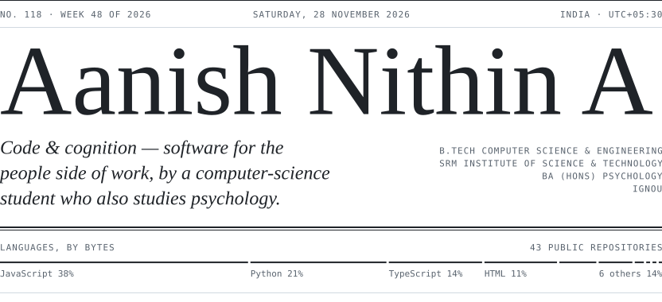

<picture>
  <source media="(prefers-color-scheme: dark)" srcset="assets/masthead-dark.svg">
  <source media="(prefers-color-scheme: light)" srcset="assets/masthead-light.svg">
  
</picture>

<picture>
  <source media="(prefers-color-scheme: dark)" srcset="assets/clock-dark.svg">
  <source media="(prefers-color-scheme: light)" srcset="assets/clock-light.svg">
  
</picture>

I'm reading for two degrees at once: computer science at SRM Institute of Science and Technology in Chennai, and psychology at IGNOU. Most of what I build sits where they meet — software about hiring, interviews, attention and habits — and I like tools that run in the browser, do one thing, and keep their data to themselves. The figures on this page are measured from my own public activity and redrawn every morning.

<picture>
  <source media="(prefers-color-scheme: dark)" srcset="assets/rule-work-dark.svg">
  <source media="(prefers-color-scheme: light)" srcset="assets/rule-work-light.svg">
  
</picture>

[gitdna](https://github.com/Aanishnithin07/gitdna) — Your code has a personality; this uses AI to extract it into a collectible developer card. My largest project. [gitdna.xyz](https://www.gitdna.xyz)

[DefogDaily](https://github.com/Aanishnithin07/DefogDaily) — A free, in-browser cognitive assessment across eight memory and attention domains, with a 28-day training protocol. [defogdaily.vercel.app](https://defogdaily.vercel.app)

[quintal](https://github.com/Aanishnithin07/quintal) — A daily archive of Indian agricultural commodity prices, in ₹ per quintal. The official feed serves only today's prices; this keeps them. Built on dbt and DuckDB, with an equivalent PySpark path for Microsoft Fabric. [aanishnithin07.github.io/quintal](https://aanishnithin07.github.io/quintal/)

[FitForge](https://github.com/Aanishnithin07/FitForge) — Scores how well a résumé fits a job description, with the matched and missing skills. Runs entirely in the browser. [hr-fitforge.vercel.app](https://hr-fitforge.vercel.app)

[PresenceAI](https://github.com/Aanishnithin07/PresenceAI) — An interview coach that watches and listens: computer vision for the non-verbal, speech recognition for the rest.

[EchoSign](https://github.com/Aanishnithin07/EchoSign) — Reads the American Sign Language alphabet from a webcam in real time.

[Synapse-Switch](https://github.com/Aanishnithin07/Synapse-Switch) — A left-brain / right-brain game whose rules switch without warning. [synapse-switch.vercel.app](https://synapse-switch.vercel.app)

Also [rage-auth-ui](https://github.com/Aanishnithin07/rage-auth-ui), a zero-trust login form: secure, because nobody can submit it.

<picture>
  <source media="(prefers-color-scheme: dark)" srcset="assets/rule-print-dark.svg">
  <source media="(prefers-color-scheme: light)" srcset="assets/rule-print-light.svg">
  
</picture>

*Inside HR: The Unspoken Rules of Recruitment and Career Growth* — self-published in 2025; I wrote, illustrated and edited it. [Amazon](https://www.amazon.in/dp/B0FR1WS8SK)

<picture>
  <source media="(prefers-color-scheme: dark)" srcset="assets/year-dark.svg">
  <source media="(prefers-color-scheme: light)" srcset="assets/year-light.svg">
  
</picture>

[Portfolio](https://portfolio-masterpiece.vercel.app/) · [LinkedIn](https://www.linkedin.com/in/aanishnithin07) · [X](https://x.com/aanishnithin) · [aanishnithin07@gmail.com](mailto:aanishnithin07@gmail.com)

<picture>
  <source media="(prefers-color-scheme: dark)" srcset="assets/foot-dark.svg">
  <source media="(prefers-color-scheme: light)" srcset="assets/foot-light.svg">
  
</picture>
